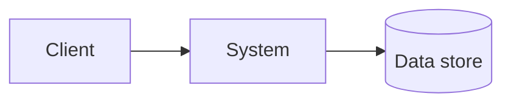

# Architecture

> Stub — replace with your system overview.

## Context

- **Users:**
- **Primary capabilities:**
- **Non-goals:**

## High-level view

Adjust or remove the diagram once you know the real shape.

## Components

| Component | Responsibility | Notes |
|-----------|----------------|-------|
| _TBD_ | | |

## Cross-cutting concerns

- **Configuration:** (env vars, config files)
- **Observability:** (logs, metrics, traces)
- **Security:** (authn/z, secrets handling)

## Related

- [Documentation index](README.md)
- Root [AGENTS.md](../AGENTS.md) for assistant conventions
