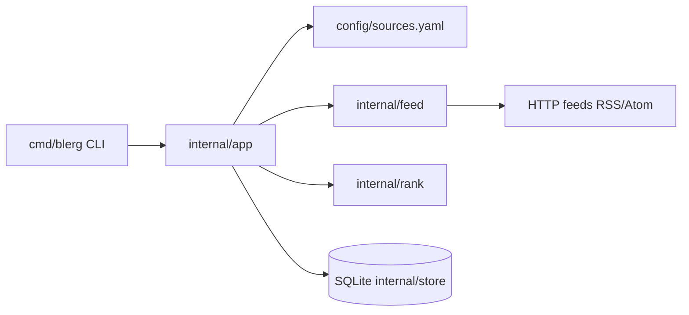

# Architecture

Blerg is a local CLI that maintains a SQLite index of posts from curated engineering-blog feeds and returns **one** ranked match per keyword query.

## Context

- **Users:** Engineers who want a single trustworthy blog post on a topic without wading through search results.
- **Primary capabilities:** `refresh` (ingest feeds), `find` (keyword search with one result), `sources list` (manifest + ingest status).
- **Non-goals (v1):** Web UI, accounts, multi-result lists, semantic/LLM ranking, HTML article fetch, paywall bypass.

## High-level view

## Components

| Component | Responsibility |
|-----------|----------------|
| `cmd/blerg` | Process entry; delegates to `internal/cli`. |
| `internal/cli` | Cobra commands, flags, human/JSON output, exit codes. |
| `internal/app` | Refresh orchestration, find + staleness trigger, HTTP fetch with cache validators and backoff. |
| `internal/config` | Load and validate sources manifest. |
| `internal/feed` | Parse RSS/Atom into normalized entries. |
| `internal/store` | SQLite schema: sources (with cache validators, ingest status), posts (unique by URL). |
| `internal/rank` | Keyword scoring, recency boost, match threshold, explanation. |
| `config/sources.yaml` | Curated allowlist shipped with the repo. |

## Command flow

**refresh:** For each enabled source (bounded concurrency), conditional GET → parse → upsert posts → update per-source success/error and HTTP validators.

**find:** If index age exceeds `--stale-after`, refresh first → score posts → print one result or no strong match (exit `2`).

**sources list:** Merge manifest rows with DB status (last success, last error).

## Cross-cutting concerns

- **Configuration:** `--db`, `--sources`, `--stale-after`, `--max-concurrent`; default manifest `config/sources.yaml`.
- **Observability:** CLI stdout/stderr only; per-source `last_error` in DB and `sources list`.
- **Security:** No secrets in v1; `User-Agent` identifies the client; local SQLite under user config dir by default.

## Related

- [Documentation index](README.md)
- [ADR 0001: RSS-first allowlist](adr/0001-rss-first-allowlist-ingestion.md)
- [MVP spec](specs/blerg-mvp-engineering-blog-finder.md)
